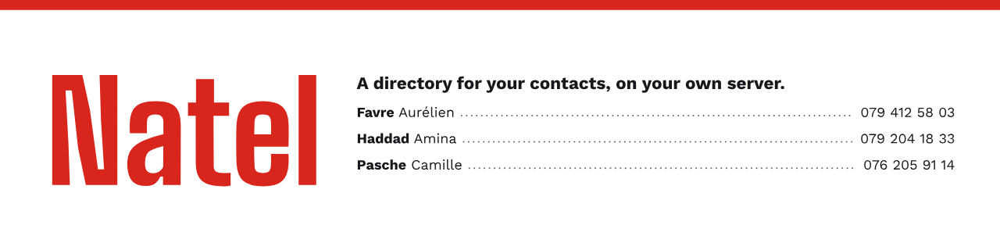
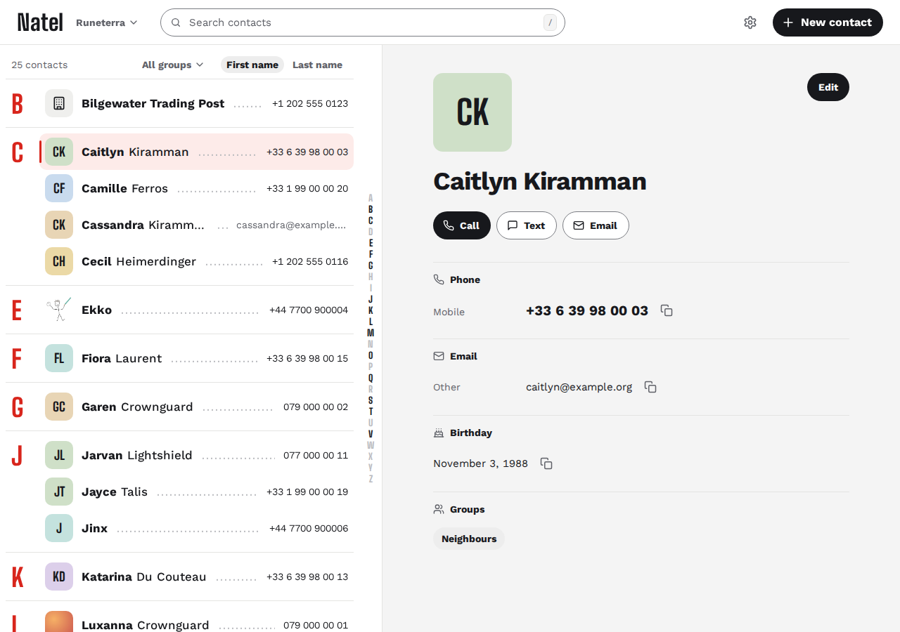
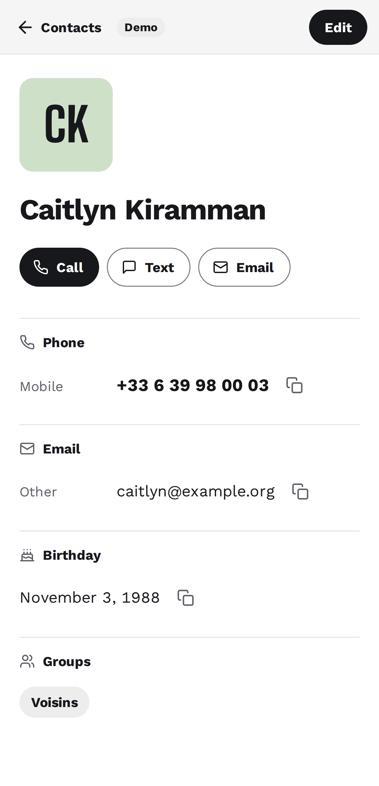

<h1>
  <picture>
    <source media="(prefers-color-scheme: dark)" srcset="docs/brand/readme/banner-dark-en.png">
    
  </picture>
</h1>

A lightweight web app to browse and edit the contacts on your CardDAV server.
Built for Baïkal, tested against Baïkal, Radicale and Xandikos.

**You need an existing CardDAV server and account.** Natel edits the same
contacts your phone and desktop clients use; it does not host a new address book.

> **Status:** alpha. The app supports contact editing, photos, groups and
> import/export. See the [roadmap](ROADMAP.md) for remaining validation and
> the [changelog](CHANGELOG.md) for released and unreleased changes.

A [hosted demo](https://kewindousse.github.io/natel/) is planned for the public
launch. Until it is published, [run the demo locally](CONTRIBUTING.md#setup).
It uses made-up contacts; edits stay in the tab and reset on reload.

<p>
  
  
</p>

## What you can do

- Search contacts, browse several address books, and move a contact between them.
- Create, edit and delete contacts; add photos and crop them.
- Filter by group and edit group membership (see [compatibility](docs/compatibility.md)).
- Import and export `.vcf` files.
- Use the app on a phone or desktop, in English or French, with light/dark mode
  and keyboard shortcuts. Install it as an app; an internet connection is required.

## Why

A CardDAV server keeps your contacts in sync across devices, but it may have
no contact editor in the browser. Natel provides that interface without
requiring a groupware suite: contacts only, one container, one server URL.

## How it handles your data

- **Preserve unedited data.** Properties, parameters and groups the editor
  does not change are kept. vCard serialisation can normalise formatting;
  the file is not guaranteed to stay byte-identical. Round-trip tests cover
  preservation, and concurrent changes are detected through ETags.
- **Small runtime.** Static files served by Caddy, which also proxies CardDAV,
  and a small session process. No Node runtime or database; see
  [architecture](docs/ARCHITECTURE.md#build).
- **Sessions in memory.** At sign-in, Natel checks your password against the
  configured CardDAV server and keeps it in the container's memory for the
  session, up to 7 days, never on disk. Your browser keeps only a session
  cookie that page scripts can't read, so a reload keeps you signed in.
  Display preferences are saved on this browser.

## Quick start

These instructions build the **current source** locally. The image changes
in [Unreleased](CHANGELOG.md#unreleased), including container port 8080, are
not in `0.2.0`. A public image containing them is still to be released.

From the root of your checkout, edit [compose.yaml](compose.yaml), replacing
`BAIKAL_URL` with your server's origin (`scheme://host[:port]`, without a path).

```yaml
services:
  natel:
    build: .
    image: ${NATEL_IMAGE:-natel:local}
    environment:
      BAIKAL_URL: https://dav.example.com
    ports:
      - "127.0.0.1:8080:8080"
```

```sh
docker compose up -d --build
```

On the machine running Docker, open `http://localhost:8080` and sign in with
your CardDAV account. This example is local only: the port is bound to
`127.0.0.1`. For access from another machine, use HTTPS and the
[deployment guide](docs/deployment.md), which includes Traefik, SWAG and
Nginx Proxy Manager examples. Natel can also [run without Docker](docs/bare-metal.md).

Natel is alpha software. Before your first edit, export each address book
from the address-book menu to keep a `.vcf` copy, or back up your CardDAV
server.

For a published image, follow the [version-specific installation notes](docs/deployment.md#published-images).
Use an explicit tag for a repeatable installation and read the release notes
before upgrading: the default ports and volume ownership can change.

## Documentation and help

- [User guide](docs/user-guide.md): contacts, photos, groups, conflicts and sign-out.
- [Compatibility](docs/compatibility.md): tested servers and clients, group formats,
  browsers and known limits.
- [Deployment](docs/deployment.md) and [updates](docs/updating.md).
- [Troubleshooting](docs/troubleshooting.md): sign-in, discovery, photos and support.
- [Issues](https://github.com/KewinDousse/natel/issues/new/choose) for bugs and feature requests.
- [Security](SECURITY.md): report vulnerabilities privately.

## Scope

Natel is a contacts client. Calendars, tasks, mail and a server-side database
are outside its scope. The UI edits a subset of vCard fields and preserves
others. Offline use, duplicate merging and delegated authentication are not
implemented.

## Development

[CONTRIBUTING.md](CONTRIBUTING.md) covers setup, checks and pull requests.
[docs/ARCHITECTURE.md](docs/ARCHITECTURE.md) explains how the app fits together.
Natel is available under the [MIT license](LICENSE).
