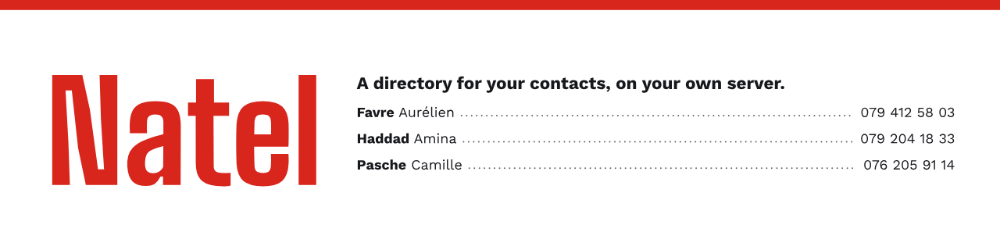
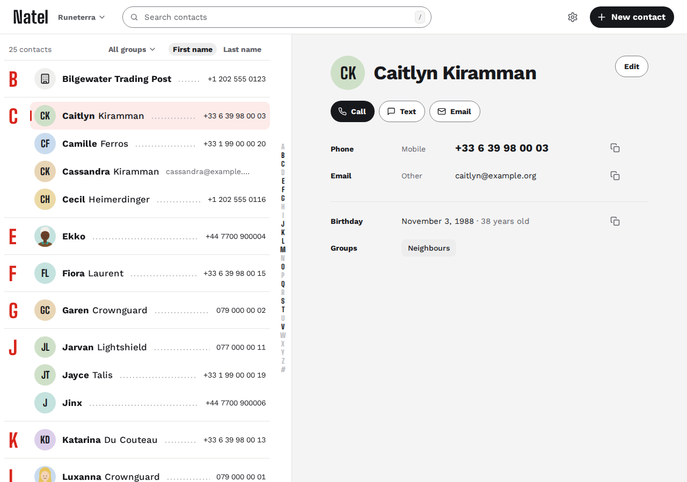
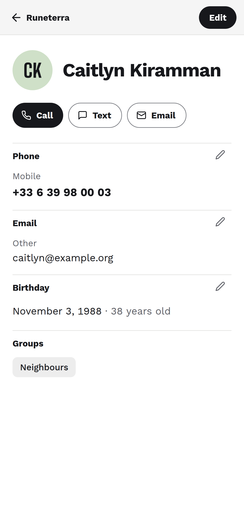

<h1>
  <picture>
    <source media="(prefers-color-scheme: dark)" srcset="docs/brand/readme/banner-dark-en.png">
    
  </picture>
</h1>

**Edit the contacts on your CardDAV server from any browser.** Your server
already keeps them in sync across your phones and computers; Natel gives you
a place to search, fix and organise them. One small container, contacts only.

### [▶ Try the demo](https://demo.natel.app/contacts)

Made-up contacts, nothing to install, edits reset on reload.

<p>
  
  
</p>

## Is Natel for you?

**Yes**, if you run Baïkal, Radicale, Xandikos or Nextcloud, or another
CardDAV server, and you want to edit your contacts somewhere other than your
phone.

**No**, if you have no CardDAV server yet (Natel doesn't host address books),
or if you also want calendars, tasks or mail.

## Run it

```yaml
services:
  natel:
    image: ghcr.io/kewindousse/natel:0.5.1
    environment:
      CARDDAV_URL: https://dav.example.com   # your server's origin, no path
    ports:
      - "127.0.0.1:8080:8080"
```

```sh
docker compose up -d
```

Open `http://localhost:8080` and sign in with your CardDAV account. To reach
it from other machines, serve it over HTTPS: the
[deployment guide](docs/deployment.md) has Traefik, SWAG and Nginx Proxy
Manager examples. Natel also [runs without Docker](docs/bare-metal.md).

## Gentle with your contacts

- **Nothing you don't edit is lost.** Fields Natel doesn't show are kept;
  tests check this on every change.
- **No silent overwrite.** If someone changed a contact on another device in
  the meantime, Natel tells you instead of saving over it.
- **Your password never touches a disk.** It stays in memory until the
  [session](docs/user-guide.md#sign-in-and-sign-out) ends.

> [!WARNING]
> Natel is beta software. Before your first edit, export each address book
> from the address-book menu, or back up your server.
> [What is tested](docs/compatibility.md).

## What it does

Search · several address books · create, edit, delete and move contacts ·
photos with cropping · groups, in [Apple, DAVx⁵ and Nextcloud
formats](docs/compatibility.md#groups) · `.vcf` import and export · phone
and desktop layouts · light and dark · English and French · keyboard
shortcuts · installable as an app.

## Learn more

- [User guide](docs/user-guide.md) · [Compatibility](docs/compatibility.md) ·
  [Deployment and updates](docs/deployment.md) ·
  [Troubleshooting](docs/troubleshooting.md)
- **What's next:** [0.6.0](https://github.com/KewinDousse/natel/milestone/1),
  then [1.0.0](https://github.com/KewinDousse/natel/milestone/2) leaves beta.
- **Update checks:** Natel looks for new releases from your server, sending
  no contacts or credentials. [Turn them off](docs/deployment.md#update-checks).
- **Help:** [open an issue](https://github.com/KewinDousse/natel/issues/new/choose);
  security reports go [privately](.github/SECURITY.md).
- **Contribute:** [CONTRIBUTING.md](CONTRIBUTING.md) runs the app on made-up
  contacts, no server needed.

[MIT license](LICENSE).
